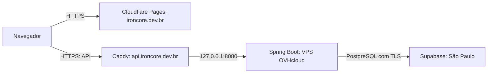

# Deploy e Produção

## Visão Geral

A implantação inicial da primeira versão funcional do IronCore foi concluída e validada em outubro de 2026. Backend e frontend estão publicados, integrados e com deploy automático funcionando. Este documento registra a operação de produção, sem alterar o histórico das releases ou representar uma nova release.

Os dados da hospedagem e a validação dos primeiros deploys foram informados pelo responsável pela implantação. Os workflows e configurações versionadas foram conferidos para esta documentação; não houve acesso ao servidor de produção. O comportamento do script instalado na VPS está descrito conforme o relato da implantação.

## Arquitetura de Produção



| Componente | Configuração de produção |
|---|---|
| API | `https://api.ironcore.dev.br` |
| Runtime | Java 21 e Spring Boot 3.5 |
| Hospedagem | OVHcloud VPS-1, Canadá; Ubuntu 26.04 LTS; 2 vCores e 4 GB de RAM |
| Processo | `ironcore-backend.service`, gerenciado pelo systemd, executado como `ironcore` |
| Escuta da aplicação | `127.0.0.1:8080` |
| Proxy reverso | Caddy, com HTTPS automático |
| Artefato instalado | `/opt/ironcore/ironcore-backend.jar` |
| Configuração sensível | `/etc/ironcore/ironcore.env`, fora do Git |
| Banco | Supabase PostgreSQL, região de São Paulo, com conexão TLS |
| Interface web | Angular 21 no Cloudflare Pages, em `https://ironcore.dev.br` |
| Domínio e DNS | Registro.br e Cloudflare, respectivamente |

O navegador consome a API pelo domínio público; a aplicação Java escuta apenas no endereço local da VPS, atrás do Caddy. O frontend não acessa diretamente o PostgreSQL. A publicação da interface está descrita no [deploy do frontend](https://github.com/renancvitor/ironcore-frontend/blob/main/docs/deploy/README.md).

## Configuração e Segurança

O perfil [`application-prod.yml`](../../src/main/resources/application-prod.yml) utiliza `DB_URL`, `DB_USER` e `DB_PASSWORD` para a conexão e habilita Flyway com `baseline-on-migrate=false`. A conexão de produção usa TLS; o conteúdo da URL e as credenciais não fazem parte desta documentação.

- CORS usa `FRONTEND_ORIGIN`, com padrão `https://ironcore.dev.br` no perfil de produção.
- A autenticação utiliza JWT no cookie `access_token`, com `HttpOnly`, `Secure` e `SameSite=Lax` em produção.
- A proteção CSRF está habilitada. O frontend obtém o token em `GET /api/auth/csrf` e o envia no header indicado pela resposta antes das operações de escrita.
- Swagger UI e API docs estão desabilitados no perfil de produção; `/actuator/health` é utilizado na verificação do deploy.
- O bootstrap inicial já foi executado e depois desabilitado em produção. As flags correspondentes são `IRONCORE_BOOTSTRAP_PERSON_ENABLED` e `IRONCORE_BOOTSTRAP_USER_ENABLED`.
- O acesso SSH usa chaves. O usuário de publicação `ironcore-deploy` é separado do acesso administrativo e do usuário `ironcore`, que executa a aplicação.
- A permissão sudo de `ironcore-deploy` é restrita ao script `/usr/local/sbin/ironcore-deploy`.

Detalhes dos contratos: [Users e Auth](../users/README.md). Credenciais, chaves privadas e o conteúdo de `/etc/ironcore/ironcore.env` devem permanecer fora do repositório.

## CI/CD do Backend

Fontes versionadas: [CI na main](https://github.com/renancvitor/ironcore-backend/blob/main/.github/workflows/ci.yml) e [CD na main](https://github.com/renancvitor/ironcore-backend/blob/main/.github/workflows/cd.yml). O CD foi conferido na `main` remota; branches anteriores à sua integração podem não conter esse arquivo.

### Integração contínua

O workflow `CI - Build & Test` executa em `push` e `pull_request` destinados à `main`, usando Java 21 Temurin e Maven Wrapper:

```bash
./mvnw clean verify --batch-mode
```

### Publicação automática

1. Um commit ou merge chega à `main` e executa o CI.
2. A conclusão do CI dispara `CD - Deploy Backend` por `workflow_run`.
3. O job de deploy exige CI aprovado, evento de origem `push`, branch `main`, repositório de origem igual ao atual e `head_sha` igual a `github.sha`, conforme a condição do workflow.
4. O checkout usa o SHA do CI aprovado. O CD recompila e executa novamente `./mvnw clean verify --batch-mode`; não reutiliza um artefato do CI.
5. O GitHub Actions prepara a chave SSH e o arquivo `known_hosts`. As conexões usam verificação estrita da chave do host e modo não interativo.
6. O arquivo `target/ironcore-backend-0.0.1-SNAPSHOT.jar` é enviado por SCP para `/home/ironcore-deploy/incoming/ironcore-backend.jar`.
7. Via SSH, o workflow executa `sudo -n /usr/local/sbin/ironcore-deploy`.
8. Na VPS, o script salva a versão anterior, instala o novo JAR, reinicia `ironcore-backend.service` e verifica `/actuator/health`.
9. Se a publicação falhar, o script tenta restaurar o JAR anterior.

O grupo de concorrência é `ironcore-backend-production`, com `cancel-in-progress: false`, evitando cancelar uma publicação em andamento ao chegar outra execução. O job tem limite de 30 minutos.

### Execução manual

O workflow também oferece `workflow_dispatch`; sua condição permite a execução manual somente na `main`. No GitHub Actions, a publicação manual é iniciada pelo workflow `CD - Deploy Backend`, selecionando essa branch. Ela também passa por build e testes antes do envio.

O primeiro CD manual e o primeiro CD automático foram executados com sucesso na implantação inicial, conforme validação informada pelo responsável pelo projeto.

### Secrets e Variables do GitHub

| Tipo | Nome | Finalidade |
|---|---|---|
| Secret | `DEPLOY_SSH_KEY` | Chave privada utilizada pelo job para acesso SSH de publicação |
| Variable | `DEPLOY_HOST` | Host de destino da VPS |
| Variable | `DEPLOY_USER` | Usuário SSH de publicação, `ironcore-deploy` |
| Variable | `DEPLOY_KNOWN_HOSTS` | Chave pública do host no formato de `known_hosts` para sua verificação |

Os valores não são reproduzidos aqui. O workflow usa `secrets` e `vars` e não declara um GitHub Environment por meio de `environment:`; não se deve presumir uma etapa de aprovação por ambiente.

## Limitações Operacionais

- **Rollback do JAR não desfaz migrations Flyway.** As migrations precisam ser compatíveis com a versão anterior que poderá ser restaurada. Restaurar o executável não recupera automaticamente schema ou dados alterados.
- O rollback é uma tentativa do script, não uma garantia de recuperação. Em falhas, é necessário avaliar o resultado da execução e o estado do serviço.
- O health check do deploy não equivale à validação de todos os fluxos funcionais da aplicação integrada.
- A aplicação é reiniciada pelo systemd durante a publicação; este fluxo não oferece garantia de deploy sem interrupção.
- Frontend e backend possuem publicações independentes. Mudanças de contrato precisam considerar a versão da interface que já está publicada.
- Não foram fornecidos procedimentos de restauração do banco, política de backups, caminho da cópia anterior do JAR ou detalhes internos de tentativas do health check. Este documento não presume essas configurações nem fornece comandos de recuperação não confirmados.

Consulte também [Banco de Dados e Migrations](../database/README.md) e [Testes Automatizados](../testing/README.md).

<p align="right"><a href="../README.md">Voltar para a documentação técnica</a></p>
