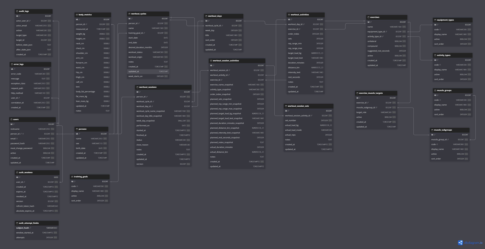
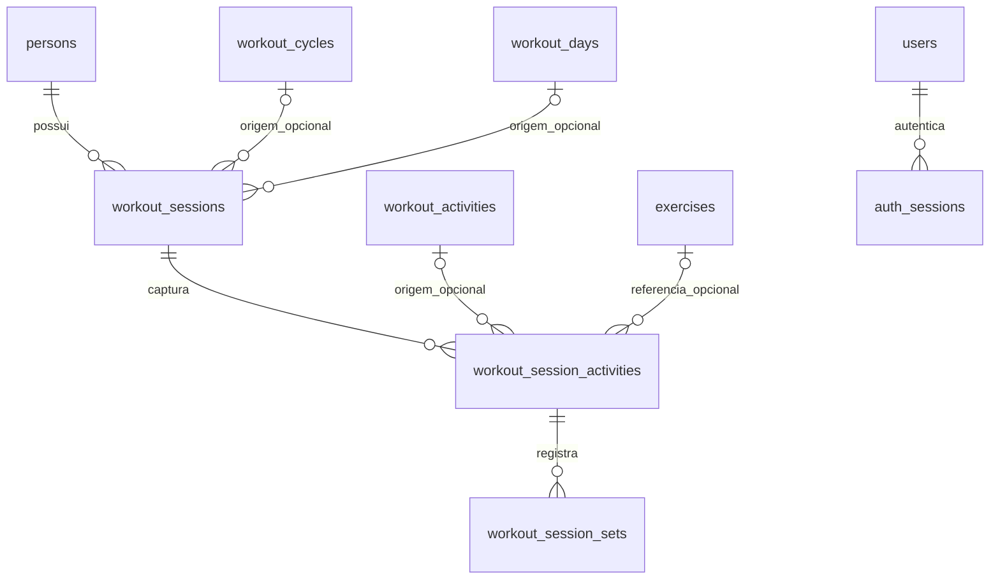

# Diagrama Entidade-Relacionamento (ER)

<p align="center">
    
</p>

## Visão Geral

Este documento descreve o modelo relacional implementado da aplicação **IronCore**. Migrations Flyway são a fonte de verdade para schema, FKs, cascades e constraints.

A posição visual das tabelas na imagem prioriza legibilidade e não representa prioridade funcional, criticidade técnica ou ordem de entrega.

A imagem inclui o planejamento, a execução de treinos e as sessões de autenticação, com o schema até a migration V31. A marca `NN` indica coluna obrigatória; checks, índices e políticas de exclusão são detalhados a partir das migrations, pois não aparecem integralmente na imagem.

## Leitura Rapida do Domínio

Modelo implementado:

- `persons`: dados pessoais.
- `users`: autenticação/acesso, com referencia para `persons`.
- `auth_sessions`: sessões persistidas de autenticação, refresh, expiração e revogação.
- `auth_attempt_limits`: contadores de tentativas por hash e janela, sem vínculo por FK com usuário.
- `body_metrics`: histórico de medições corporais da pessoa.
- `audit_logs`: registros persistidos de auditoria.
- `error_logs`: registros técnicos de erro.
- `activity_types`, `equipment_types`, `muscle_groups` e `muscle_subgroups`: catálogos auxiliares globais.
- `exercises`: catálogo de exercícios.
- `exercise_muscle_targets`: associação entre exercícios e subgrupos musculares.

Workout planning implementado no diagrama:

- `training_goals`: catálogo de objetivos de treino.
- `workout_cycles`: ciclos ou planos de treino da pessoa.
- `workout_days`: divisão semanal do ciclo.
- `workout_activities`: atividades prescritas em cada dia de treino.

Workout session implementado no diagrama:

- `workout_sessions`: sessões executadas pela pessoa, com snapshots do ciclo e dia de origem.
- `workout_session_activities`: atividades capturadas no início, com prescrição histórica e execução informada.
- `workout_session_sets`: séries registradas, com carga, modo, repetições e relatos opcionais.

## Decisão Estrutural Principal

O modelo atual separa dados pessoais, conta de acesso, medições corporais, planejamento e execução:

```text
Person = dados pessoais
User = autenticação/acesso
BodyMetrics = métricas corporais da pessoa
AuthSession = sessão de autenticação da conta
WorkoutCycle / WorkoutDay / WorkoutActivity = planejamento
WorkoutSession / WorkoutSessionActivity / WorkoutSessionSet = execução
```

Consequências:

- `users.person_id` referencia `persons.id`.
- `body_metrics.person_id` referencia `persons.id`.
- `workout_cycles.person_id` e `workout_sessions.person_id` referenciam `persons.id`.
- `auth_sessions.user_id` referencia `users.id`: sessão de autenticação e sessão de treino são conceitos distintos.
- Snapshots da sessão preservam o planejamento capturado, mesmo após alteração ou exclusão da origem.
- A API pode continuar partindo do usuário autenticado.
- A ownership interna de dados físicos passa a ser baseada em `PersonId`.

## Tabelas Implementadas

### `persons`

Armazena os dados pessoais vinculados ao usuário e aos dados corporais.

| Campo | Tipo | Obrigatório | Descricao |
|---|---|---|---|
| `id` | `BIGINT` | Sim | Identificador único da pessoa. |
| `name` | `VARCHAR` | Sim | Nome da pessoa. Não possui unicidade. |
| `sex` | `VARCHAR` | Sim | Sexo usado em regras corporais, como cálculo Navy. |
| `birth_date` | `DATE` | Sim | Data de nascimento. |
| `created_at` | `TIMESTAMP` | Sim | Data e hora de criação do registro. |
| `updated_at` | `TIMESTAMP` | Não | Data e hora da última atualização. |

### `users`

Armazena credenciais, identificação de conta e estado técnico de acesso.

| Campo | Tipo | Obrigatório | Descricao |
|---|---|---|---|
| `id` | `BIGINT` | Sim | Identificador único do usuário. |
| `nickname` | `VARCHAR` | Sim | Nome de exibição/conta. |
| `person_id` | `BIGINT` | Sim | Pessoa vinculada ao usuário. |
| `email` | `VARCHAR` | Sim | E-mail único para autenticação. |
| `password_hash` | `VARCHAR` | Sim | Hash da senha do usuário. |
| `must_change_password` | `BOOLEAN` | Sim | Indica troca obrigatória de senha inicial. |
| `active` | `BOOLEAN` | Sim | Status técnico de acesso. |
| `created_at` | `TIMESTAMP` | Sim | Data e hora de criação do registro. |
| `updated_at` | `TIMESTAMP` | Não | Data e hora da última atualização. |

### `auth_sessions`

Armazena sessões de autenticação da conta, independentes das sessões de treino.

| Campo | Tipo | Obrigatório | Descrição |
|---|---|---:|---|
| `id` | `UUID` | Sim | Identificador da sessão, referenciado pelo claim JWT `sid`. |
| `user_id` | `BIGINT` | Sim | Conta proprietária da sessão. |
| `created_at` | `TIMESTAMPTZ` | Sim | Instante de criação. |
| `expires_at` | `TIMESTAMPTZ` | Sim | Expiração da sessão por inatividade. |
| `revoked_at` | `TIMESTAMPTZ` | Não | Instante de revogação. |
| `version` | `BIGINT` | Sim | Versão para controle de concorrência; padrão `0`. |
| `refresh_token_hash` | `VARCHAR(64)` | Não | Hash do refresh token; aceita ausência em registros anteriores à sua introdução. |
| `absolute_expires_at` | `TIMESTAMPTZ` | Sim | Limite absoluto da sessão. |

Expiração do JWT, validade da sessão e retenção do registro são distintas. A política de 30 dias de inatividade, renovação por refresh válido, teto de 90 dias e transição de registros antigos está em [Users e Auth](../../users/README.md).

### `auth_attempt_limits`

Armazena contadores de tentativas por sujeito e janela de tempo. A tabela aparece isolada no diagrama porque não possui FK para `users` ou `auth_sessions`.

| Campo | Tipo | Obrigatório | Descrição |
|---|---|---:|---|
| `subject_hash` | `VARCHAR(64)` | Sim | Hash identificador do sujeito; chave primária. |
| `window_started_at` | `TIMESTAMPTZ` | Sim | Início da janela de contagem. |
| `attempts` | `INTEGER` | Sim | Número não negativo de tentativas. |

### `body_metrics`

Registra o histórico de medições corporais de cada pessoa.

| Campo | Tipo | Obrigatório | Descricao |
|---|---|---|---|
| `id` | `BIGINT` | Sim | Identificador único da medição. |
| `person_id` | `BIGINT` | Sim | Pessoa dona da medição. |
| `measured_at` | `TIMESTAMP` | Sim | Data e hora em que a medição foi registrada. |
| `weight_kg` | `DOUBLE PRECISION` | Sim | Peso corporal em quilogramas. |
| `height_cm` | `DOUBLE PRECISION` | Sim | Altura em centímetros. |
| `neck_cm` | `DOUBLE PRECISION` | Não | Medida do pescoço em centímetros. |
| `chest_cm` | `DOUBLE PRECISION` | Não | Medida do tórax em centímetros. |
| `shoulder_cm` | `DOUBLE PRECISION` | Não | Medida do ombro em centímetros. |
| `arm_cm` | `DOUBLE PRECISION` | Não | Medida do braço em centímetros. |
| `forearm_cm` | `DOUBLE PRECISION` | Não | Medida do antebraço em centímetros. |
| `waist_cm` | `DOUBLE PRECISION` | Não | Medida da cintura em centímetros. |
| `hip_cm` | `DOUBLE PRECISION` | Não | Medida do quadril em centímetros. |
| `thigh_cm` | `DOUBLE PRECISION` | Não | Medida da coxa em centímetros. |
| `calf_cm` | `DOUBLE PRECISION` | Não | Medida da panturrilha em centímetros. |
| `bmi` | `DOUBLE PRECISION` | Não | Índice de Massa Corporal. |
| `body_fat_percentage` | `DOUBLE PRECISION` | Não | Percentual de gordura corporal. |
| `fat_mass_kg` | `DOUBLE PRECISION` | Não | Massa gorda em quilogramas. |
| `lean_mass_kg` | `DOUBLE PRECISION` | Não | Massa magra em quilogramas. |
| `updated_at` | `TIMESTAMP` | Não | Data e hora da última atualização. |
| `notes` | `TEXT` | Não | Observações livres sobre a medição. |

### `audit_logs`

Armazena registros de auditoria de ações relevantes.

A tabela existe nas migrations atuais e é documentada em [Audit Log](../../logging/audit-log.md).

### `error_logs`

Armazena registros técnicos de erro.

A tabela existe nas migrations atuais e é documentada em [Error Log](../../logging/error-log.md).

### `activity_types`

Classifica a natureza da atividade física.

| Campo | Tipo | Obrigatório | Descricao |
|---|---|---|---|
| `id` | `BIGINT` | Sim | Identificador único do tipo de atividade. |
| `code` | `VARCHAR` | Sim | Código estável do catálogo. |
| `display_name` | `VARCHAR` | Sim | Nome para apresentação. |
| `active` | `BOOLEAN` | Sim | Indica se o item está ativo. |
| `sort_order` | `INTEGER` | Sim | Ordem de exibição. |

### `equipment_types`

Classifica o tipo de equipamento exigido no exercício.

| Campo | Tipo | Obrigatório | Descricao |
|---|---|---|---|
| `id` | `BIGINT` | Sim | Identificador único do tipo de equipamento. |
| `code` | `VARCHAR` | Sim | Código estável do catálogo. |
| `display_name` | `VARCHAR` | Sim | Nome para apresentação. |
| `active` | `BOOLEAN` | Sim | Indica se o item está ativo. |
| `sort_order` | `INTEGER` | Sim | Ordem de exibição. |

### `muscle_groups`

Classifica grupamentos musculares principais.

| Campo | Tipo | Obrigatório | Descricao |
|---|---|---|---|
| `id` | `BIGINT` | Sim | Identificador único do grupo muscular. |
| `code` | `VARCHAR` | Sim | Código estável do catálogo. |
| `display_name` | `VARCHAR` | Sim | Nome para apresentação. |
| `active` | `BOOLEAN` | Sim | Indica se o item está ativo. |
| `sort_order` | `INTEGER` | Sim | Ordem de exibição. |

### `muscle_subgroups`

Classifica subgrupos musculares vinculados a um grupamento principal.

| Campo | Tipo | Obrigatório | Descricao |
|---|---|---|---|
| `id` | `BIGINT` | Sim | Identificador único do subgrupo muscular. |
| `muscle_group_id` | `BIGINT` | Sim | Grupo muscular vinculado. |
| `code` | `VARCHAR` | Sim | Código estável do catálogo. |
| `display_name` | `VARCHAR` | Sim | Nome para apresentação. |
| `active` | `BOOLEAN` | Sim | Indica se o item está ativo. |
| `sort_order` | `INTEGER` | Sim | Ordem de exibição. |

### `exercises`

Catalogo central de exercícios disponíveis para a composição atual de `workout_activities`.

| Campo | Tipo | Obrigatório | Descricao |
|---|---|---|---|
| `id` | `BIGINT` | Sim | Identificador único do exercise. |
| `name` | `VARCHAR` | Sim | Nome do exercício. |
| `equipment_type_id` | `BIGINT` | Sim | Tipo de equipamento vinculado. |
| `activity_type_id` | `BIGINT` | Sim | Tipo de atividade vinculado. |
| `unilateral` | `BOOLEAN` | Sim | Indica exercício unilateral. |
| `compound` | `BOOLEAN` | Sim | Indica exercício composto. |
| `suggested_rest_seconds` | `INTEGER` | Não | Descanso sugerido em segundos. |
| `active` | `BOOLEAN` | Sim | Indica se o exercise está ativo. |
| `created_at` | `TIMESTAMP` | Sim | Data e hora de criação. |
| `updated_at` | `TIMESTAMP` | Não | Data e hora da última atualização. |

### `exercise_muscle_targets`

Associa exercises a subgrupos musculares e diferencia o papel do alvo muscular.

| Campo | Tipo | Obrigatório | Descricao |
|---|---|---|---|
| `id` | `BIGINT` | Sim | Identificador único da associação. |
| `exercise_id` | `BIGINT` | Sim | Exercise vinculado. |
| `muscle_subgroup_id` | `BIGINT` | Sim | Subgrupo muscular vinculado. |
| `target_role` | `VARCHAR` | Sim | Papel do alvo muscular: `PRIMARY`, `SECONDARY` ou `STABILIZER`. |
| `active` | `BOOLEAN` | Sim | Indica se a associação está ativa. |
| `created_at` | `TIMESTAMP` | Sim | Data e hora de criação. |
| `updated_at` | `TIMESTAMP` | Não | Data e hora da última atualização. |

## Tabelas de Workout Planning

### `training_goals`

Representa o objetivo principal do ciclo de treino.

| Campo | Tipo | Obrigatório | Descrição |
|---|---|---:|---|
| `id` | `BIGINT` | Sim | Identificador do objetivo. |
| `code` | `VARCHAR(50)` | Sim | Código único do catálogo. |
| `display_name` | `VARCHAR(100)` | Sim | Nome de apresentação. |
| `active` | `BOOLEAN` | Sim | Disponibilidade do objetivo. |
| `sort_order` | `INTEGER` | Sim | Ordem de apresentação. |

### `workout_cycles`

Representa um ciclo de treino associado a uma pessoa e a um objetivo específico.

| Campo | Tipo | Obrigatório | Descrição |
|---|---|---:|---|
| `id` | `BIGINT` | Sim | Identificador do ciclo. |
| `person_id` | `BIGINT` | Sim | Pessoa proprietária. |
| `name` | `VARCHAR(150)` | Sim | Nome do ciclo. |
| `training_goal_id` | `BIGINT` | Sim | Objetivo vinculado. |
| `start_date` / `end_date` | `DATE` | Não | Datas do lifecycle. |
| `desired_duration_months` | `INTEGER` | Não | Duração desejada. |
| `workout_status` / `workout_origin` | `VARCHAR(50)` | Sim | Estado e origem do ciclo. |
| `week_starts_on` | `INTEGER` | Sim | Início da semana para apresentação; padrão `1` (`SUNDAY`), introduzido pela V23. |
| `notes` | `TEXT` | Não | Observações. |
| `created_at` / `updated_at` | `TIMESTAMP` | Sim / Não | Timestamps do registro. |

### `workout_days`

Organiza os dias de treino vinculados a um ciclo.

| Campo | Tipo | Obrigatório | Descrição |
|---|---|---:|---|
| `id` | `BIGINT` | Sim | Identificador do dia. |
| `workout_cycle_id` | `BIGINT` | Sim | Ciclo vinculado. |
| `week_day` | `INTEGER` | Sim | Valor entre 1 e 7. |
| `title` | `VARCHAR(100)` | Sim | Título do dia. |
| `sort_order` | `INTEGER` | Sim | Ordem positiva dentro do ciclo e dia da semana. |
| `created_at` / `updated_at` | `TIMESTAMP` | Sim / Não | Timestamps do registro. |

### `workout_activities`

Detalha cada atividade prescrita dentro de um dia de treino.

| Campo | Tipo | Obrigatório | Descrição |
|---|---|---:|---|
| `id` | `BIGINT` | Sim | Identificador da atividade. |
| `workout_day_id` / `exercise_id` | `BIGINT` | Sim | Dia e exercise vinculados. |
| `order_index` | `INTEGER` | Sim | Ordem da atividade no dia. |
| `sets`, `rep_range_min`, `rep_range_max`, `duration_minutes`, `rest_seconds` | `INTEGER` | Não | Dados opcionais de prescrição. |
| `target_load_kg`, `distance_km` | `NUMERIC(5,2)` | Não | Dados numéricos opcionais. |
| `target_load_text`, `intensity_text` | `VARCHAR(100)` | Não | Dados textuais opcionais. |
| `notes` | `TEXT` | Não | Observações opcionais. |
| `created_at` / `updated_at` | `TIMESTAMP` | Sim / Não | Timestamps do registro. |

## Tabelas de Workout Session

### `workout_sessions`

Registra a execução de um dia de treino pela pessoa, preservando os dados de origem em snapshots.

| Campo | Tipo | Obrigatório | Descrição |
|---|---|---:|---|
| `id` | `BIGINT` | Sim | Identificador da sessão de treino. |
| `person_id` | `BIGINT` | Sim | Pessoa proprietária da execução. |
| `workout_cycle_id` / `workout_day_id` | `BIGINT` | Não | Referências ao planejamento de origem; podem ser removidas sem apagar os snapshots. |
| `workout_cycle_name_snapshot` | `VARCHAR(150)` | Sim | Nome do ciclo capturado no início. |
| `workout_day_title_snapshot` | `VARCHAR(100)` | Sim | Título do dia capturado no início. |
| `week_day_snapshot` | `SMALLINT` | Sim | Dia da semana capturado, entre 1 e 7. |
| `performed_on` | `DATE` | Sim | Data do início no fuso `America/Sao_Paulo`. |
| `started_at` | `TIMESTAMPTZ` | Sim | Instante de início. |
| `finished_at` | `TIMESTAMPTZ` | Não | Instante do encerramento; obrigatório quando `CLOSED`. |
| `status` | `VARCHAR(30)` | Sim | `IN_PROGRESS` ou `CLOSED`. |
| `close_reason` | `VARCHAR(30)` | Não | `MANUAL` ou `AUTO_EXPIRED`; obrigatório quando encerrada. |
| `notes` | `TEXT` | Não | Relato da sessão. |
| `created_at` / `updated_at` | `TIMESTAMPTZ` | Sim / Não | Instantes de criação e atualização. |
| `version` | `BIGINT` | Sim | Versão para controle de concorrência; padrão `0`. |

### `workout_session_activities`

Captura a prescrição de cada atividade e mantém os dados informados de execução separados dos valores planejados.

| Campo | Tipo | Obrigatório | Descrição |
|---|---|---:|---|
| `id` | `BIGINT` | Sim | Identificador da atividade da sessão. |
| `workout_session_id` | `BIGINT` | Sim | Sessão proprietária. |
| `workout_activity_id` / `exercise_id` | `BIGINT` | Não | Atividade planejada e exercício de origem. |
| `exercise_name_snapshot` | `VARCHAR(150)` | Sim | Nome capturado do exercício. |
| `activity_type_snapshot` | `VARCHAR(50)` | Sim | Código capturado do tipo de atividade. |
| `order_index_snapshot` | `INTEGER` | Sim | Ordem positiva da atividade na sessão. |
| `planned_sets_snapshot` | `INTEGER` | Não | Quantidade planejada de séries. |
| `planned_rep_range_min_snapshot` / `planned_rep_range_max_snapshot` | `INTEGER` | Não | Faixa planejada de repetições. |
| `planned_target_load_kg_snapshot` | `NUMERIC(8,2)` | Não | Carga numérica planejada. |
| `planned_target_load_text_snapshot` | `VARCHAR(100)` | Não | Prescrição textual de carga. |
| `planned_duration_minutes_snapshot` | `INTEGER` | Não | Duração planejada em minutos. |
| `planned_distance_km_snapshot` | `NUMERIC(8,2)` | Não | Distância planejada em quilômetros. |
| `planned_intensity_text_snapshot` | `VARCHAR(100)` | Não | Intensidade planejada. |
| `planned_rest_seconds_snapshot` | `INTEGER` | Não | Descanso planejado em segundos. |
| `planned_notes_snapshot` | `TEXT` | Não | Observações capturadas da prescrição. |
| `actual_duration_minutes` | `INTEGER` | Não | Duração efetivamente informada. |
| `actual_distance_km` | `NUMERIC(8,2)` | Não | Distância efetivamente informada. |
| `notes` | `TEXT` | Não | Relato de execução da atividade. |
| `created_at` / `updated_at` | `TIMESTAMPTZ` | Sim / Não | Instantes de criação e atualização. |

### `workout_session_sets`

Registra séries da atividade, inclusive dados parciais de execução.

| Campo | Tipo | Obrigatório | Descrição |
|---|---|---:|---|
| `id` | `BIGINT` | Sim | Identificador da série. |
| `workout_session_activity_id` | `BIGINT` | Sim | Atividade executada proprietária. |
| `set_number` | `INTEGER` | Sim | Número positivo e único dentro da atividade. |
| `actual_load_kg` | `NUMERIC(8,2)` | Não | Carga informada, não negativa. |
| `actual_load_mode` | `VARCHAR(20)` | Não | `TOTAL` ou `PER_SIDE`; obrigatório se houver carga. |
| `actual_reps` | `INTEGER` | Não | Repetições informadas, positivas quando presentes. |
| `notes` | `TEXT` | Não | Relato da série. |
| `created_at` / `updated_at` | `TIMESTAMPTZ` | Sim / Não | Instantes de criação e atualização. |

`normalizedLoadKg` é calculado para as respostas e indicadores; não é coluna persistida. A execução não é preenchida automaticamente com os valores dos snapshots. Regras funcionais: [Workout Session](../../workout-session/README.md).

## Relacionamentos

Relacionamentos implementados:

- `persons` 1:1 `users`
- `persons` 1:N `body_metrics`
- `equipment_types` 1:N `exercises`
- `activity_types` 1:N `exercises`
- `muscle_groups` 1:N `muscle_subgroups`
- `muscle_subgroups` 1:N `exercise_muscle_targets`
- `exercises` 1:N `exercise_muscle_targets`

Relacionamentos implementados de workout planning:

- `persons` 1:N `workout_cycles`
- `training_goals` 1:N `workout_cycles`
- `workout_cycles` 1:N `workout_days`
- `workout_days` 1:N `workout_activities`
- `exercises` 1:N `workout_activities`

Relacionamentos implementados de execução e autenticação:

- `persons` 1:N `workout_sessions`
- `workout_cycles` 1:N `workout_sessions`, com origem opcional em cada sessão
- `workout_days` 1:N `workout_sessions`, com origem opcional em cada sessão
- `workout_sessions` 1:N `workout_session_activities`
- `workout_activities` 1:N `workout_session_activities`, com origem opcional em cada atividade executada
- `exercises` 1:N `workout_session_activities`, com referência opcional em cada atividade executada
- `workout_session_activities` 1:N `workout_session_sets`
- `users` 1:N `auth_sessions`

`auth_attempt_limits` não possui relacionamentos por FK. Os snapshots textuais preservam informações de origem, mas não constituem referências relacionais adicionais.

## Constraints de Workout Planning

- `workout_cycles.person_id` usa `ON DELETE CASCADE`; `training_goal_id` não possui cascade explícito.
- `workout_days.workout_cycle_id` e `workout_activities.workout_day_id` usam `ON DELETE CASCADE`; `exercise_id` não possui cascade explícito.
- `workout_days` possui `UNIQUE (workout_cycle_id, week_day, sort_order) DEFERRABLE INITIALLY DEFERRED`, `CHECK (week_day BETWEEN 1 AND 7)` e `CHECK (sort_order > 0)`.
- `workout_activities` possui `UNIQUE (workout_day_id, order_index) DEFERRABLE INITIALLY DEFERRED` e `UNIQUE (workout_day_id, exercise_id)`.

## Constraints de Workout Session e Autenticação

- `workout_sessions.person_id` usa `ON DELETE CASCADE`; referências a ciclo e dia usam `ON DELETE SET NULL`.
- O índice único parcial `uk_workout_sessions_person_in_progress` permite no máximo uma sessão `IN_PROGRESS` por pessoa.
- Checks de sessão relacionam status, fim e motivo: `IN_PROGRESS` não tem encerramento; `CLOSED` exige `finished_at` e `close_reason`. A data local corresponde ao início em São Paulo; o fim respeita o limite de 03h do dia seguinte, e `AUTO_EXPIRED` usa exatamente esse limite.
- `workout_session_activities.workout_session_id` usa cascade; referências à atividade planejada e ao exercício usam `SET NULL`. A ordem é positiva e única por sessão; a faixa planejada de repetições deve ser consistente.
- `workout_session_sets.workout_session_activity_id` usa cascade e o número da série é positivo e único por atividade. A constraint final da V27 exige carga e modo juntos e pelo menos carga, repetições ou relato não vazio. Uniformidade de modo entre séries é regra de domínio, não check SQL entre linhas.
- `auth_sessions.user_id` usa cascade. A expiração é posterior à criação e a revogação, quando presente, não pode antecedê-la. O hash do refresh aceita `NULL`; quando preenchido, exige 64 caracteres hexadecimais minúsculos e possui índice único.
- A V31 exige `expires_at <= absolute_expires_at`, com limite absoluto posterior à criação e até 2160 horas após ela. Registros anteriores recebem seu `expires_at` existente como teto absoluto.
- `auth_attempt_limits.subject_hash` é chave primária, `attempts >= 0` e há índice em `window_started_at` para limpeza. `auth_sessions` possui índice em `user_id`; sessões de treino e atividades também possuem índices nas referências consultadas.

O diagrama não substitui o detalhamento das migrations V24–V31 em [Banco de Dados](../../database/README.md).

## Fluxo Logico do Domínio

De forma resumida, o fluxo implementado funciona assim:

1. uma `person` possui dados pessoais;
2. um `user` referencia uma `person` para autenticar e acessar o sistema;
3. `body_metrics` registra medições corporais da `person`;
4. `exercises` registra o catálogo global controlado pelo sistema;
5. cada exercise é classificado por equipamento, tipo de atividade e alvos musculares;
6. a mesma `person` pode possuir vários `workout_cycles`;
7. cada `workout_cycle` é criado com base em um `training_goal`, com `week_starts_on` configurável;
8. cada ciclo é dividido em vários `workout_days`;
9. cada dia contém várias `workout_activities`;
10. cada atividade aponta para um item do catálogo `exercises`;
11. ao iniciar a execução, `workout_sessions` registra a pessoa e captura os dados do ciclo/dia, enquanto `workout_session_activities` captura os exercícios e a prescrição;
12. a execução informada fica nas atividades da sessão e em `workout_session_sets`, sem alterar o planejamento;
13. `auth_sessions` mantém as credenciais de sessão da conta; `auth_attempt_limits` mantém os contadores dos fluxos de autenticação limitados.

## Observações de Modelagem

- `Person` é a base de dados pessoais.
- `User` é a conta de autenticação/acesso.
- `BodyMetrics` pertence a `PersonId`.
- Planejamento e execução de treinos também pertencem a `PersonId`; sessões de autenticação pertencem à conta de usuário.
- `users.person_id` é único no modelo atual.
- `body_metrics.person_id` permite histórico N:1 de medições corporais por pessoa.
- Catálogos de exercises são globais e controlados pelo sistema.
- A API atual do catálogo expõe consultas e não CRUD público.
- A imagem deste diagrama foi criada com o [dbdiagram.io](https://dbdiagram.io/).

## Complemento Atual: Execução e Autenticação

A imagem no início já inclui `workout_cycles.week_starts_on`, as tabelas de execução e as tabelas de autenticação. O Mermaid abaixo complementa essa imagem com uma leitura resumida dos relacionamentos de V24–V31.



`auth_attempt_limits` mantém contadores independentes por hash e janela. Sessões de treino têm snapshots, data local, status/motivo e versão; atividades capturam a prescrição e execução parcial; séries guardam carga/modo/repetições/relato. Sessões de autenticação têm UUID, expirações móvel/absoluta, revogação, hash do refresh e versão. Tipos, cascades e constraints: [Banco de Dados](../../database/README.md).

<p align="right"><a href="../../../README.md">Voltar para a documentação completa</a></p>
