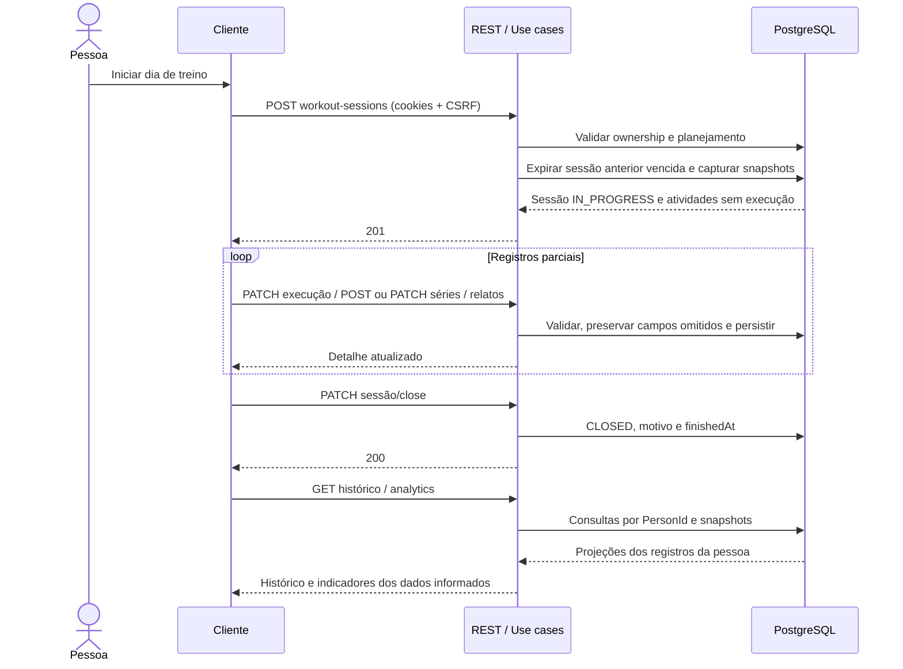

# Diagrama de Sequência de Registro

    

## Visão Geral

Este documento descreve o fluxo temporal de registro da execução de treino no projeto **IronCore / Personal Trainer AI**.

O diagrama mostra como usuário, frontend, backend e persistência relacional interagem durante uma sessão real de treino.

Este é um diagrama de sequência. Portanto, ele representa a ordem das interações no tempo, e não a estrutura interna da arquitetura.

A imagem preserva a representação conceitual original. Seus rótulos `start workout session`, `save activity log`, `save set log`, `finish session` e `workout summary` representam etapas, não nomes de endpoints. Os nomes `workout_session_log`, `workout_activity_log` e `workout_activity_set_log` da imagem correspondem, na implementação atual, a `workout_sessions`, `workout_session_activities` e `workout_session_sets`.

O fluxo textual e o Mermaid abaixo detalham o backend implementado. A participação do Angular representa o consumo da API e não comprova que cada operação já possui interface entregue no frontend.

## Leitura rápida do fluxo

- `User`: atleta que registra a execução do treino.
- `Angular`: cliente web que consome a API durante a sessão de treino.
- `Spring Boot`: backend principal que valida, coordena e persiste os registros da sessão.
- `PostgreSQL`: persistência relacional principal da aplicação.

## Objetivo do diagrama

Este diagrama foi criado para mostrar o fluxo principal de registro operacional de uma sessão de treino.

Ele ajuda a entender:

1. como a sessão de treino é iniciada;
2. como atividades executadas são registradas;
3. como séries realizadas são persistidas;
4. como a sessão é encerrada;
5. como dados de encerramento, detalhe, histórico e indicadores são retornados ao cliente.

O diagrama prioriza clareza e fluxo principal. Algumas etapas técnicas foram simplificadas propositalmente.

## Participantes do fluxo

- `User`: atleta que inicia, executa e finaliza a sessão de treino.
- `Angular`: aplicação cliente que envia registros e apresenta as respostas da API.
- `Spring Boot`: backend principal. Centraliza autenticação, validações, regras da sessão e persistência dos dados.
- `PostgreSQL`: base relacional principal do sistema, responsável por armazenar os registros da execução.

## Fluxo lógico da execução do treino

De forma resumida, o fluxo de execução funciona assim:

1. o `User` solicita o início do treino no `Angular`;
2. o `Angular` envia `POST /api/users/me/workout-sessions` com `workoutCycleId`, `workoutDayId`, cookies e CSRF;
3. o `Spring Boot` valida ownership por `PersonId`, ciclo `IN_PROGRESS`, vínculo do dia e existência de atividades planejadas;
4. o `Spring Boot` trata a sessão anterior vencida e persiste `workout_sessions` e `workout_session_activities`, capturando snapshots sem preencher execução ou criar séries automaticamente;
5. o `PostgreSQL` confirma a persistência e o `Spring Boot` retorna `201 Created` com os dados iniciais da sessão;
6. o `User` informa execução ou relato de uma atividade no `Angular`;
7. o `Angular` envia `PATCH /api/users/me/workout-sessions/{id}/activities/{activityId}/execution`;
8. o `Spring Boot` valida e atualiza duração, distância e/ou relato em `workout_session_activities`, preservando campos omitidos;
9. o `PostgreSQL` confirma a persistência e o `Spring Boot` retorna `200 OK` com o detalhe atualizado da atividade;
10. o `User` registra uma série realizada no `Angular`;
11. o `Angular` envia `POST /api/users/me/workout-sessions/{id}/activities/{activityId}/sets`;
12. o `Spring Boot` valida número da série, carga/modo, repetições e relato, e persiste `workout_session_sets`;
13. o `PostgreSQL` confirma a persistência e o `Spring Boot` retorna `201 Created` com o detalhe da série;
14. o `User` solicita a finalização do treino no `Angular`;
15. o `Angular` envia `PATCH /api/users/me/workout-sessions/{id}/close`, sem body;
16. o `Spring Boot` atualiza `workout_sessions` para `CLOSED`, com motivo `MANUAL` ou `AUTO_EXPIRED`, conforme o limite de expiração;
17. o `PostgreSQL` confirma a persistência e o `Spring Boot` retorna `200 OK` com os dados do encerramento;
18. o `Angular` pode consultar o detalhe por `GET /api/users/me/workout-sessions/{id}`, o histórico paginado e os indicadores por exercício;
19. o `Angular` utiliza essas respostas para apresentar registros e indicadores ao `User`. O fechamento não retorna um resumo analítico consolidado.

### Diagrama complementar do fluxo implementado

Os caminhos no Mermaid estão abreviados para legibilidade; os endpoints completos estão no fluxo textual e em [Workout Session](../../workout-session/README.md).

## Dados registrados durante a sessão

O `start workout session` da imagem corresponde à abertura operacional da sessão de treino.

- vínculo com ciclo e dia de treino;
- ownership por `PersonId`, resolvido a partir do usuário autenticado;
- snapshots do nome do ciclo, título do dia, dia da semana, exercícios e prescrição das atividades;
- data local `performedOn` e instante `startedAt`;
- status inicial `IN_PROGRESS`.

O `log activity` e o `save activity log` correspondem à atualização da execução de uma atividade já capturada no início.

- `actualDurationMinutes`: duração informada em minutos inteiros positivos;
- `actualDistanceKm`: distância informada em quilômetros, não negativa;
- `notes`: relato opcional;
- execução parcial, sem assumir valores planejados como realizados.

Não há status individual de exercício iniciado/concluído nem campo específico de dificuldade percebida nesse contrato.

O `log set` e o `save set log` correspondem aos registros específicos de séries realizadas.

- `setNumber`: número positivo e único na atividade;
- `actualReps`: repetições informadas, quando presentes;
- `actualLoadKg` e `actualLoadMode`: carga real e modo `TOTAL` ou `PER_SIDE`, informados em conjunto;
- `notes`: relato opcional da série;
- `normalizedLoadKg`: valor derivado na resposta, preservando a carga em `TOTAL` e multiplicando por dois em `PER_SIDE`, sem acrescentar peso presumido de barra, corpo ou equipamento.

Uma série pode conter somente carga/modo, somente repetições ou somente relato não vazio. RIR/RPE e tempo individual da série não possuem campos implementados.

O `finish session` corresponde ao encerramento da sessão de treino.

- `finishedAt`: instante de encerramento;
- status `CLOSED`;
- `closeReason`: `MANUAL` ou `AUTO_EXPIRED`;
- preservação dos registros parciais e relatos existentes.

Relatos da sessão são enviados separadamente por `PATCH /api/users/me/workout-sessions/{id}/notes`. Não há status de sessão concluída, parcial ou cancelada: uma execução incompleta também é encerrada como `CLOSED`.

O `workout summary` representa conceitualmente a apresentação dos dados ao usuário. Na API atual, essas informações são obtidas em consultas distintas.

- detalhe da sessão com snapshots, execução das atividades e séries;
- histórico paginado de sessões encerradas;
- evolução de força por exercício, com carga normalizada e volume calculável;
- evolução de cardio por exercício, com distância, duração, pace e velocidade média quando houver dados suficientes.

O backend não presume execução a partir do planejamento. Métricas sem os dados necessários permanecem ausentes, em vez de serem preenchidas com zero. Fórmulas e regras de elegibilidade estão em [Workout Session](../../workout-session/README.md).

## Responsabilidades não representadas explicitamente

Algumas responsabilidades importantes não aparecem no diagrama para manter o fluxo simples e legível.

- Autenticação ocorre por cookie `access_token` e sessão de autenticação ativa; escritas também exigem CSRF.
- Ownership, vínculos entre sessão/atividade/série e invariantes são validados no backend.
- Erros de rede e retries não foram representados; o diagrama não pressupõe idempotência de criação de sessão ou série.
- Auditoria, logs técnicos, métricas e observabilidade não aparecem no desenho.
- Sincronização offline não está implementada nesse fluxo.
- Registros de execução, séries e relatos podem ser enviados repetidamente durante a sessão.
- O scheduler verifica expiração a cada 60 segundos. O limite é 03h do dia seguinte a `performedOn`, no fuso `America/Sao_Paulo`; `AUTO_EXPIRED` grava `finishedAt` nesse limite e preserva dados parciais.
- O início de nova sessão e as mutações de execução/relatos também tratam vencimento. Consultas GET não processam a expiração por si só.
- Correções de execução, séries, modo e relatos são permitidas após fechamento, sem reabrir a sessão nem alterar snapshots ou datas do lifecycle.

## Limites deste diagrama

Este diagrama:

- mostra a sequência temporal da execução real do treino;
- destaca o fluxo principal entre frontend, backend e persistência relacional;
- evidencia a criação, atualização e persistência dos registros operacionais da sessão.

Este diagrama não pretende:

- detalhar a arquitetura interna do backend;
- representar todas as validações e regras de negócio;
- detalhar tratamento de falhas, retentativas ou sincronização offline;
- mostrar todos os eventos técnicos de observabilidade;
- substituir diagramas estruturais ou de domínio da aplicação;
- afirmar que todos os recursos de apresentação do cliente já foram entregues.

## Observações finais

- O `Spring Boot` é o ponto central de validação e persistência do fluxo.
- O `PostgreSQL` mantém os registros relacionais da execução do treino.
- O fluxo pode ter vários registros de atividade e série antes do encerramento da sessão, além de correções posteriores.
- Planejamento e execução são separados: alterações posteriores da origem não reescrevem os snapshots históricos.
- A imagem original foi criada com o [diagrams.net](https://app.diagrams.net/); o Mermaid complementa sua leitura com o contrato atual.

<a href="../../../README.md">🔄 Voltar para a documentação completa</a>

