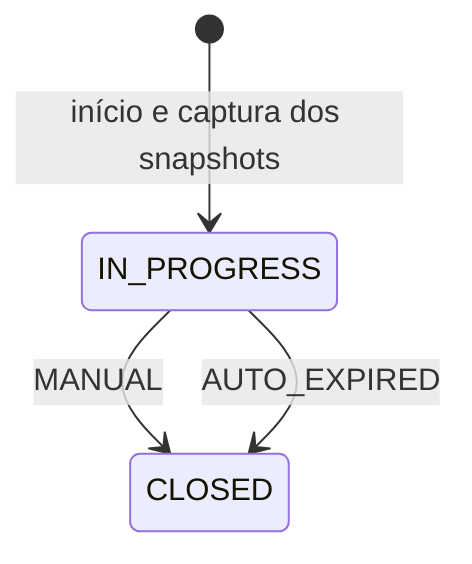

# Documentação de Workout Session

## Propósito

O módulo registra a execução real de treinos, separada da prescrição em [Workout Planning](../workout-planning/README.md). Planejamento não comprova execução: iniciar uma sessão captura snapshots, mas não preenche cargas, repetições, duração, distância ou séries realizadas.

## Modelo e Ownership

- `WorkoutSession` é o aggregate proprietário de `WorkoutSessionActivity` e `WorkoutSessionSet`.
- A sessão pertence a `PersonId`, resolvido pelo usuário autenticado nas rotas `/api/users/me`. O cliente não escolhe o proprietário no body.
- A atividade guarda a identidade opcional da atividade planejada e do exercício, o snapshot da prescrição e a execução informada.
- A série guarda `setNumber`, `actualLoadKg`, `actualLoadMode`, `actualReps` e `notes`.
- Consultas e alterações restringem sessão e planejamento à pessoa autenticada; atividade e série precisam pertencer aos respectivos pais. Recursos de outra pessoa não são expostos.

## Snapshots Históricos

No início, são capturados `workoutCycleNameSnapshot`, `workoutDayTitleSnapshot` e `weekDaySnapshot`. Cada atividade captura nome do exercício, código do tipo de atividade, ordem e todos os campos planejados: séries, faixa de repetições, carga numérica/textual, duração, distância, intensidade, descanso e observações.

Alterações posteriores no planejamento ou no catálogo não reescrevem os snapshots. As referências a ciclo, dia, atividade planejada e exercício aceitam `NULL` e usam `ON DELETE SET NULL`; a exclusão física da origem preserva o histórico. A exclusão de `Person` usa cascade e remove suas sessões. As regras funcionais de exclusão do planejamento continuam mais restritivas que os cascades físicos.

## Início e Lifecycle

O início exige ciclo `IN_PROGRESS`, dia pertencente ao ciclo e à pessoa, e ao menos uma atividade planejada. Não exige coincidência entre o dia da semana atual e o dia prescrito.

Existe no máximo uma sessão `IN_PROGRESS` por pessoa, garantida também por índice único parcial. Uma tentativa concorrente ou uma nova abertura enquanto houver sessão em andamento pode retornar `409 Conflict`.

A persistência bloqueia e relê ciclo, dia, atividades, exercícios e tipos necessários à captura, comparando a prescrição ao snapshot antes de inserir. Alteração concorrente da origem pode gerar `409`; o cliente deve recarregar o planejamento antes de tentar novamente.



- `performedOn` é a data de `startedAt` no fuso `America/Sao_Paulo`.
- O limite é **03h do dia seguinte a `performedOn`**, inclusive para início entre meia-noite e 03h.
- Encerramento manual antes do limite grava `MANUAL` e o instante atual. Se o limite já passou, grava `AUTO_EXPIRED`, com `finishedAt` exatamente no limite; `updatedAt` registra o processamento.
- O scheduler tenta expirar sessões a cada 60 segundos. O início de uma nova sessão também trata a sessão vencida, sem depender dessa execução periódica. Mutações de execução e relatos verificam expiração.
- `GET /in-progress` recupera a sessão persistida; não expira por si só uma sessão vencida. Retorna `404` se não existir registro em andamento.
- Encerramento preserva registros parciais e não exige execução de todas as atividades ou séries planejadas. Não existe reabertura nem endpoint REST de expiração.

## Execução Parcial e Edição Posterior

Relatos (`notes`) são opcionais na sessão, atividade e série. Duração e repetições, quando informadas, são inteiros positivos. Carga e distância aceitam zero, até `999999.99`, com no máximo duas casas decimais.

Uma série exige número positivo e único dentro da atividade, e pelo menos carga, repetições ou relato não vazio. Carga exige modo; modo sem carga é inválido. São permitidas séries apenas com repetições, apenas com carga e modo, ou apenas com relato. Não há criação automática de séries a partir de `plannedSetsSnapshot`.

PATCH de execução, série e relatos distingue campo omitido (preserva) de `null` explícito (limpa, respeitando as invariantes). Body sem campo atualizável é inválido. Limpar todos os dados de uma série não é permitido; para removê-la, use DELETE.

Mesmo após `CLOSED`, o proprietário pode corrigir relatos, execução, séries e modo de carga. Isso não reabre a sessão, não altera snapshots, `performedOn`, `startedAt`, `finishedAt` nem motivo de encerramento. As consultas analíticas refletem os registros corrigidos. O aggregate usa versão para controle de concorrência e as mutações publicam auditoria.

## Modos de Carga

| Modo | `normalizedLoadKg` |
|---|---|
| `TOTAL` | `actualLoadKg` |
| `PER_SIDE` | `actualLoadKg × 2` |
| Sem carga | `null` |

`PER_SIDE` representa dois lados equivalentes explicitamente informados. O cálculo não acrescenta peso da barra, corpo ou equipamento e não é inferido de exercício unilateral. Todas as séries com carga da mesma atividade devem usar o mesmo modo. O endpoint `load-mode` altera o modo das séries com carga em conjunto, preservando o valor numérico informado; isso recalcula a carga normalizada, sem converter o número para manter o total anterior. O `actualLoadMode` da atividade é derivado das séries e fica ausente sem carga.

## Endpoints

Todos exigem cookie `access_token` válido e sessão de autenticação ativa. Escritas também exigem CSRF; consulte [Users e Auth](../users/README.md).

Base: `/api/users/me/workout-sessions`.

| Método e sufixo | Resultado de sucesso |
|---|---|
| `POST` na base | `201`, identificação e dados iniciais da sessão |
| `GET /in-progress` | `200`, detalhe da sessão em andamento |
| `GET /{id}` | `200`, detalhe com snapshots, atividades e séries |
| `PATCH /{id}/close` | `200`, dados do encerramento; sem body de entrada |
| `PATCH /{id}/notes` | `200`, detalhe da sessão |
| `PATCH /{id}/activities/{activityId}/execution` | `200`, detalhe da atividade |
| `POST /{id}/activities/{activityId}/sets` | `201`, detalhe da série |
| `PATCH /{id}/activities/{activityId}/sets/{setId}` | `200`, detalhe da série |
| `DELETE /{id}/activities/{activityId}/sets/{setId}` | `204`, sem body |
| `PATCH /{id}/activities/{activityId}/load-mode` | `200`, detalhe da atividade |
| `GET` na base | `200`, histórico paginado de sessões encerradas |
| `GET /analytics/exercises/{exerciseId}/strength` | `200`, evolução de força por sessão |
| `GET /analytics/exercises/{exerciseId}/cardio` | `200`, pontos e resumo de cardio |

### Exemplos de Requisição

Iniciar (`POST` na base):

```json
{ "workoutCycleId": 1, "workoutDayId": 2 }
```

Exemplo de resposta de início (`201`; ids e horários ilustrativos):

```json
{
  "id": 10,
  "workoutCycleId": 1,
  "workoutDayId": 2,
  "performedOn": "2026-11-04",
  "startedAt": "2026-11-04T15:00:00Z",
  "status": "IN_PROGRESS",
  "createdAt": "2026-11-04T15:00:00Z"
}
```

Registrar série (`POST /{id}/activities/{activityId}/sets`):

```json
{ "setNumber": 1, "actualLoadKg": 20.00, "actualLoadMode": "PER_SIDE", "actualReps": 10, "notes": "Boa execução" }
```

Nesse exemplo, `normalizedLoadKg` na resposta é `40.00`. A resposta também contém `id`, `setNumber`, os campos `actual*`, `notes`, `createdAt` e `updatedAt`.

Registrar cardio (`PATCH /{id}/activities/{activityId}/execution`):

```json
{ "actualDurationMinutes": 30, "actualDistanceKm": 5.00 }
```

Limpar relato (`PATCH /{id}/notes`):

```json
{ "notes": null }
```

Alterar modo comum (`PATCH /{id}/activities/{activityId}/load-mode`):

```json
{ "actualLoadMode": "TOTAL" }
```

## Histórico, Filtros e Paginação

O histórico retorna somente `CLOSED`, incluindo `MANUAL` e `AUTO_EXPIRED`. Aceita filtros opcionais combinados `workoutCycleId`, `workoutDayId`, `startDate`, `endDate` e `name`; datas ISO `YYYY-MM-DD` filtram `performedOn` inclusivamente. `name` busca trecho do nome do ciclo ou título do dia **nos snapshots**, sem distinguir maiúsculas; espaços externos são removidos e `%`, `_` e `!` são tratados literalmente.

`page` começa em zero (padrão `0`) e `size` aceita `1..100` (padrão `20`). Ordenação fixa: `performedOn DESC, startedAt DESC, id DESC`. O envelope é `sessions`, um `PageResult` com `content`, `page`, `size`, `totalElements`, `totalPages` e `last`. Cada item contém ids de origem opcionais, snapshots do ciclo/dia/semana, data, início, fim, status e motivo. Referências removidas não podem mais corresponder a filtros por id; a busca textual continua usando snapshots.

## Indicadores de Evolução

As duas consultas por exercício exigem `startDate` e `endDate`, inclusivas, sem datas futuras, com início até fim e limite `endDate <= startDate.plusMonths(12).minusDays(1)`. Usam apenas sessões encerradas da pessoa e o `exerciseId` ainda associado, com pontos em ordem cronológica (`performedOn`, `startedAt`, id). Não dependem do nome atual do catálogo; os pontos retornam `exerciseNameSnapshot` e `workoutDayTitleSnapshot`. Sem correspondência, `points` é vazio. Sem referência ao exercício após sua exclusão física, a atividade preserva snapshots, mas deixa de participar da consulta por aquele id.

### Força

- `maxNormalizedLoadKg`: maior carga normalizada entre séries com carga, modo e repetições positivas; não estima 1RM.
- `volumeKgReps`: soma de carga normalizada × repetições das séries elegíveis.
- `registeredSetCount`: todas as séries registradas; `loadedSetCount`: séries com carga normalizável; `volumeSetCount`: séries com carga e repetições para cálculo.
- Uma carga sem repetições conta em `loadedSetCount`, mas não entra no máximo nem no volume. Sem séries elegíveis, essas métricas são `null`, não zero.

### Cardio

- Distância e duração somam apenas valores informados; ausência não é preenchida pela prescrição.
- Pace médio: soma das durações / soma das distâncias apenas das atividades com duração positiva e distância positiva.
- Velocidade média: `60 × soma das distâncias / soma das durações` das atividades com duração positiva e distância não negativa. Distância zero permite velocidade zero, mas não pace.
- Razões usam duas casas e `HALF_UP`; são médias da duração informada, sem comprovar tempo em movimento ou velocidade instantânea.
- Pontos expõem `distanceKm`, `durationMinutes`, `averagePaceMinPerKm`, `averageSpeedKmPerHour`, `activityCount` e contadores de registros elegíveis. O `summary` traz `totalDistanceKm`, `totalDurationMinutes`, médias e contadores do período, recalculados pelos totais elegíveis; não é média aritmética dos pontos.

## Erros e Validação

| Status | Cenário |
|---|---|
| `400` | JSON/tipos inválidos, body vazio de PATCH, invariantes de sessão/atividade/série, campos negativos ou precisão inválida |
| `401` | Access token ausente/inválido, sessão de autenticação expirada ou revogada |
| `403` | CSRF ausente/inválido ou usuário inativo nos casos de uso |
| `404` | Recurso não encontrado no recorte da pessoa, ou sem sessão em andamento |
| `409` | Conflito de sessão em andamento ou concorrência no aggregate |
| `422` | Período invertido no histórico ou regras de período analítico inválidas |

Os erros seguem o modelo comum da API; detalhes em [Exceptions](../exceptions/README.md). Contratos completos: `WorkoutSessionApi`, `ExerciseAnalyticsApi` e DTOs em `interfaces/rest/workoutsession`; não há CRUD público de snapshots ou endpoint para adicionar nova atividade à sessão.

## Persistência e Testes

Migrations V24–V27 criam o aggregate e permitem registros parciais. Constraints, referências e índices estão em [Banco de Dados](../database/README.md).

`WorkoutSessionIntegrationTest` cobre Flyway em PostgreSQL vazio, início e recuperação sem preenchimento da execução, planejamento inválido, autenticação/CSRF, isolamento por pessoa, registros parciais, encerramento, expiração com e sem scheduler, correção após encerramento, histórico com snapshots e exclusão da origem, força e cardio com dados ausentes. Há testes adicionais de domínio, casos de uso, controllers, PATCH, segurança, concorrência/persistência e consultas PostgreSQL. A existência desses testes não substitui o resultado de uma execução; veja [Testes](../testing/README.md).

<p align="right"><a href="../README.md">Voltar para a documentação técnica</a></p>
